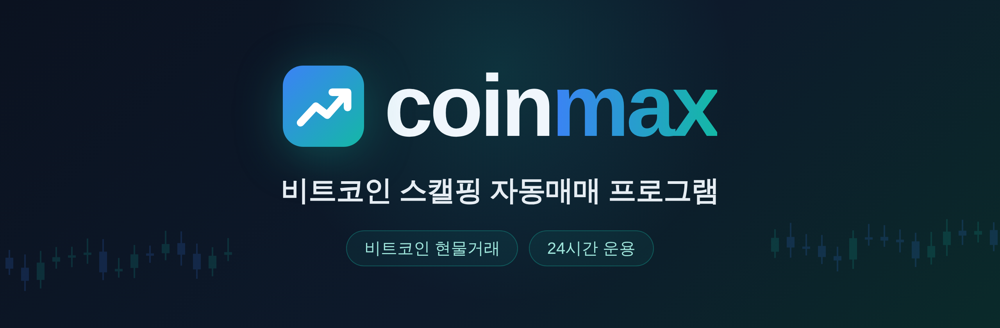
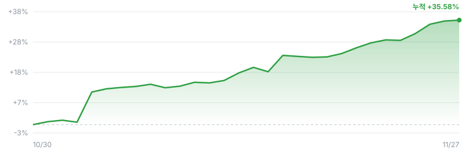

coinmax는 비트코인 **스캘핑(초단타) 자동매매 프로그램**입니다. 로우리스크 로우리턴으로 복리를 노립니다.

## 📈 성과

<!-- STATS:START -->

  
  
  

### 어제 성과 (2026-11-20)

| 수익률 | 익절 비율 | 가동 시간 | 누적 |
|:---:|:---:|:---:|:---:|
| **+1.56%** 🟢 | 75% | 24시간 | +26.14% |

### 최근 7일

| 날짜 | 수익률 | 익절 비율 | 가동 |
|:---:|---:|:---:|:---:|
| 11/20 | +1.56% 🟢 | 75% | 24h |
| 11/19 | +0.93% 🟢 | 79% | 24h |
| 11/18 | +0.11% 🟢 | 88% | 24h |
| 11/17 | -0.26% 🔴 | 74% | 24h |
| 11/16 | -0.28% 🔴 | 80% | 23h |
| 11/15 | +4.72% 🟢 | 77% | 24h |
| 11/14 | -1.24% 🔴 | 72% | 23.8h |

<b>전체 기록 보기 (2026-10-30 부터, 손실 난 날 포함)</b>

| 날짜 | 수익률 | 누적 | 익절 비율 | 가동 |
|:---:|---:|---:|:---:|:---:|
| 2026-11-20 | +1.56% 🟢 | +26.14% | 75% | 24h |
| 2026-11-19 | +0.93% 🟢 | +24.20% | 79% | 24h |
| 2026-11-18 | +0.11% 🟢 | +23.06% | 88% | 24h |
| 2026-11-17 | -0.26% 🔴 | +22.92% | 74% | 24h |
| 2026-11-16 | -0.28% 🔴 | +23.24% | 80% | 23h |
| 2026-11-15 | +4.72% 🟢 | +23.59% | 77% | 24h |
| 2026-11-14 | -1.24% 🔴 | +18.02% | 72% | 23.8h |
| 2026-11-13 | +1.63% 🟢 | +19.50% | 75% | 24h |
| 2026-11-12 | +2.24% 🟢 | +17.59% | 83% | 24h |
| 2026-11-11 | +0.70% 🟢 | +15.02% | 74% | 17h |
| 2026-11-10 | -0.19% 🔴 | +14.21% | 79% | 23.7h |
| 2026-11-09 | +1.17% 🟢 | +14.43% | 89% | 24h |
| 2026-11-08 | +0.48% 🟢 | +13.11% | 91% | 23.9h |
| 2026-11-07 | -1.03% 🔴 | +12.57% | 68% | 24h |
| 2026-11-06 | +0.65% 🟢 | +13.75% | 92% | 24h |
| 2026-11-05 | +0.31% 🟢 | +13.01% | 89% | 24h |
| 2026-11-04 | +0.41% 🟢 | +12.67% | 84% | 23.8h |
| 2026-11-03 | +1.01% 🟢 | +12.21% | 88% | 23.9h |
| 2026-11-02 | +10.16% 🟢 | +11.09% | 73% | 20.1h |
| 2026-11-01 | -0.66% 🔴 | +0.85% | 71% | 15.9h |
| 2026-10-31 | +0.51% 🟢 | +1.51% | 74% | 0h |
| 2026-10-30 | +1.00% 🟢 | +1.00% | 67% | 0h |

<!-- STATS:END -->

<!-- SCREENS: 화면 캡처 올린 뒤 살림
## 이런 프로그램이에요

<table>
<tr>
<td width="50%"></td>
<td width="50%"></td>
</tr>
<tr>
<td><b>한 화면에서 전부</b> 매매 상태, 손익, 코인, 시스템 로그를 관리 화면 하나에서 봅니다.</td>
<td><b>버튼 하나로 시작과 정지</b> 시작, 정지, 긴급 종료. 폰 텔레그램으로도 원격 제어됩니다.</td>
</tr>
<tr>
<td width="50%"></td>
<td width="50%"></td>
</tr>
<tr>
<td><b>순손익 실시간 집계</b> 모든 수익은 매수, 매도 수수료를 뺀 순수익으로 계산합니다.</td>
<td><b>코인을 골라 추적</b> 거래가 활발한 코인을 자동으로 추천하고, 직접 골라 넣을 수도 있습니다.</td>
</tr>
<tr>
<td width="50%"></td>
<td width="50%"></td>
</tr>
<tr>
<td><b>보유 코인 관리</b> 봇이 산 코인은 봇이 끝까지 책임지고 팝니다. 필요하면 화면에서 직접 정리합니다.</td>
<td><b>판단 기록과 안전장치</b> 왜 샀는지, 왜 안 샀는지 전부 기록합니다. 장이 무너지면 스스로 멈춥니다.</td>
</tr>
</table>

화면의 숫자, 설정값, 로그는 매매 로직 보호를 위해 가렸습니다.

-->

## 특징

| | |
|---|---|
| ⚡ **스캘핑** | 호가창의 움직임을 실시간으로 읽고 짧게 들어가 짧게 나옵니다 |
| 🛡️ **리스크 관리** | 시장 급락 감지 시 신규 매수 중단, 단계별 손실 관리, 비상 정지 |
| 🌙 **24시간 작동** | 밤낮없이 쉬지 않고 작동 |
| 📱 **원격 알림, 제어** | 텔레그램 알림과 폰 원격 시작, 정지 |
| 🧾 **순수익 기준** | 모든 수익률은 왕복 수수료를 뺀 값 |

## 자주 묻는 질문

<b>소스 코드는 공개하나요?</b>

매매 로직과 설정값은 비공개입니다. 이 저장소에는 매일 성과 기록만 올라옵니다.

<b>수익률은 어떻게 계산하나요?</b>

그날 끝난 거래의 순손익(수수료 차감)을 그날 0시 자산으로 나눈 값입니다. 입금과 출금은 수익에서 뺍니다. 누적 수익률은 일 수익률을 복리로 곱한 값입니다.

<b>손실 난 날도 올리나요?</b>

네. 개발 첫날부터 모든 날을 그대로 올립니다. 기록이 비어 있는 날은 봇이 꺼져 있던 날입니다.

<b>구매가 가능한가요?</b>

프로그램 및 매매 데이터 판매하지 않습니다. 개인 프로젝트 기록입니다.

---

투자 권유가 아닙니다. 과거 수익이 미래 수익을 보장하지 않으며, 코인 투자는 원금 손실 위험이 있습니다.

마음에 드셨다면 ⭐ 하나가 큰 힘이 됩니다.
